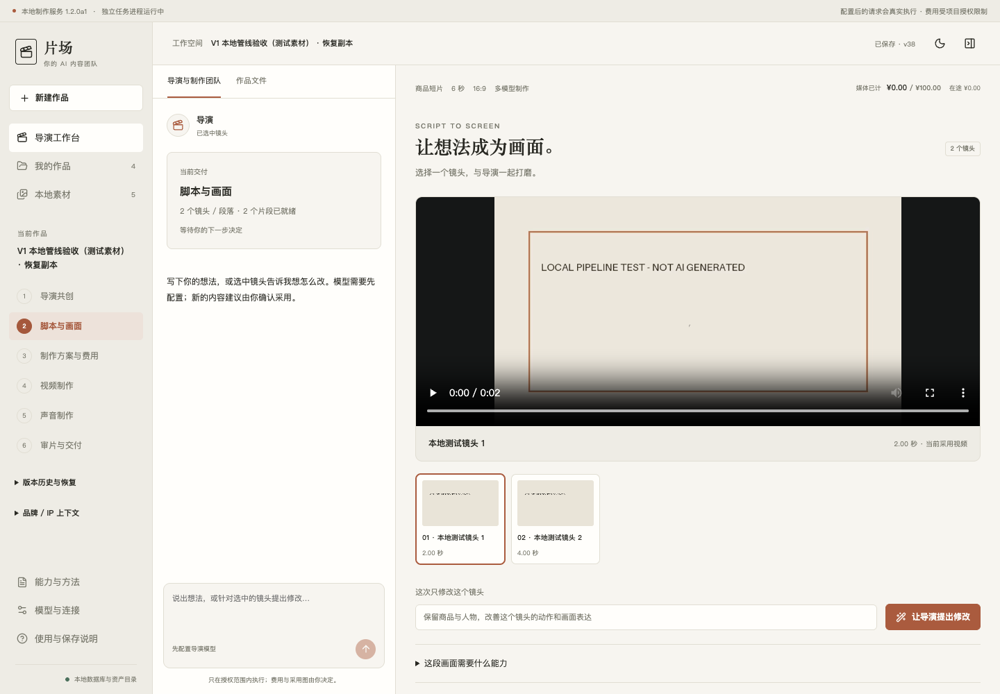
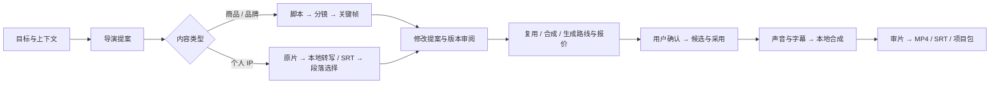

<div align="center">

# 片场 · Director Studio

### 把想法变成视频，把修改留在可控范围内。

A local-first AI video workbench for product stories and creator-led content.

[](LICENSE)
[](docs/known-limitations.md)

[English](README.en.md) · [快速安装](docs/installation.md) · [使用教程](docs/user-guide.md) · [详细功能](docs/features.md) · [产品价值与同类研究](docs/market-research.md)

</div>

片场是一款面向商品/品牌短视频和个人 IP 口播、访谈、知识内容的开源制作工作台。
你与导演一起确认方向；镜头、文稿、关键帧和候选版本在同一个项目里逐步打磨；
生成、原片复用、声音和字幕经过明确的采用与费用检查后再交付。

它尤其适合这种工作：**第一个镜头已经满意，只想改第二个镜头；一段访谈观点很好，
只想删去重复段落；团队试了很多模型，但没人说得清每次修改花了多少钱。**

首发为 **v1.2.0-alpha.1**，适合愿意配置本机环境的创作者、内部内容制作人员与开发者试用。
已验证目标平台为 Apple Silicon Mac；没有原生安装包、多用户协作或外部插件市场。
软件开源不等于生成模型免费，也不保证所有供应商、型号和商用素材质量已验证。

## 先了解它能帮你什么

| 你的工作 | 片场提供的帮助 |
|---|---|
| 商品短片、品牌故事 | 从导演提案到脚本、分镜、关键帧、候选视频；已满意镜头保留，修改范围可审阅 |
| 口播、访谈 | 本地句段转写、点击文字定位原片、保留/剪除/重排、修订字幕和句段边界 |
| 知识视频 | 复用脚本、图片/视频、旁白、字幕与本地合成流程 |
| 经常反复修改 | 采用前比较候选；回退到旧镜头或最近内容版本，原始素材不被覆盖 |
| 需要核算制作费用 | 查看路线报价、费用预留与记录；先检查已有素材能否复用，再考虑生成 |
| 想扩展专业方法 | 阅读或改造两个版本化内置 Skill，通过白名单命令与预算入口执行 |

## 主要特色

1. **创作意图与实际产物并排。** 左侧项目上下文，中间导演和交付进度，右侧分镜或文稿/原片；可折叠、可调宽。
2. **局部修改可回退。** 新生成结果登记为候选，采用后才替换当前版本；过期任务不能覆盖新内容。
3. **原片也是制作路线。** 静态展示可以用原图合成；真实商品或本人表达可以直接选取原片区间。
4. **改字幕与剪声音明确分开。** 改正一个术语不会意外删掉原声；段落选择在“应用到剪辑”后才生效。
5. **模型建议有边界。** 按账户、接口、输入、时长、规格和预算筛选，展示主方案、备用方案、排除理由与证据；当前是规则推荐，不是学习出的“最佳模型”。
6. **制作过程可带走。** 导出 MP4、SRT 与项目 ZIP；项目包含素材、候选、费用历史和最近 50 个版本，恢复后重新确认交付。

这些是产品的组合特点，并非声称同类产品都没有。完整对照与证据见 [市场研究](docs/market-research.md)。



*截图使用程序生成的测试色卡与本地合成片段；不含客户素材，也不是 AI 生成效果展示。*

## 安装与启动

需要 Apple Silicon Mac、Git、uv、Node.js 22+（含 npm）、FFmpeg。首次安装需要网络，速度取决于环境和依赖缓存。

```bash
git clone https://github.com/Gavinluo19/director-studio.git
cd director-studio
bash scripts/start.sh
```

打开 **http://127.0.0.1:8768/**。保持启动终端运行；`Control+C` 同时停止 API 与 Worker。
也可以在 Finder 双击 `启动片场.command`。脚本是手动启动入口，不会配置开机自启。
运行日志保存在本机数据目录的 `logs/api.log` 和 `logs/worker.log`。

### 第一条视频可以不调用收费模型

用你自己的短视频和带时间戳的 SRT：新建个人内容 → 上传原片 → 导入 SRT → 选择段落 →
应用到剪辑 → 确认创作与原片复用路线 → 保留原声 → 本地合成 → 审片和导出。
没有 SRT 时可先准备可选的本地 Whisper 权重，或运行下面的合成素材验证。

```bash
uv sync --project app/backend --locked --extra dev --extra transcription
app/backend/.venv/bin/python scripts/verify_local_flow.py
```

验证只使用自生成色卡/音调与 FFmpeg，输出到 `app/verification/`，不连接付费模型，也不是 AI 视频质量演示。
它使用独立的 8878 端口与测试数据目录，检验任务、字幕、声音、导出和恢复。

### 本地自动转写：单独准备权重

```bash
app/backend/.venv/bin/python scripts/download_asr.py --yes
```

此命令显式下载 `mlx-community/whisper-large-v3-turbo` 权重到本机缓存，不上传媒体。
准备后刷新“能力与方法”。软件发布包不包含权重；下载占用网络和磁盘，模型受其自身许可证约束。
缺权重/依赖时不会自动切换云端 ASR，仍可导入 SRT。

## 配置 AI 模型

在“模型与连接”填写自己的服务连接、实际模型 ID、支持规格和价格/费用上限，检查连接后再启用。
预设是可编辑的配置起点，不是每个账户都能调用的保证；型号、API 与价格会变化。
导演/脚本、生图、视频、配音和音乐可以使用不同模型。Codex 通道还需要实际可用的订阅登录。
云端调用会按所配置供应商发送任务所需的文本、参考图片或帧。
费用账本是应用内的预留与估算/对账记录，不是供应商账单，也不是信用卡限额。

## 两条主流程



## 当前质量边界

- 自动转写为句段级；没有逐字精确剪切、多说话人识别或复杂转场承诺。
- 推荐规则不保证商品文字、人物身份和动作连续性；真实产物必须审阅。
- 本机保存项目，转写/合成可本地运行；启用云端模型时会发送所需输入。详见 [隐私与安全](SECURITY.md)。
- 最终成片须在当前版本审片确认后导出；原片、字幕和项目包依然可能包含个人或客户内容。
- 前台服务随终端停止；首次发布提供可见错误与日志，可选常驻服务仍在路线图。
- 技术测试、真实模型调用、业务内容签收是三种证据，不相互替代。首发验证见 [验证说明](docs/verification.md)。

## 开发与贡献

React + TypeScript、FastAPI、SQLite、独立 Worker、FFmpeg、可选 MLX Whisper。
任务使用修订、幂等键、预算事务和进程租约；Skill 方法与执行工具分离。

```bash
uv sync --project app/backend --locked --extra dev
app/backend/.venv/bin/python -m pytest app/backend/tests -q
npm --prefix app/frontend ci --ignore-scripts --no-audit --no-fund
npm --prefix app/frontend test
npm --prefix app/frontend run build
```

[贡献指南](CONTRIBUTING.md) · [架构与 API](docs/architecture.md) · [已知限制](docs/known-limitations.md) · [路线图](docs/roadmap.md)

欢迎提供可脱敏的真实创作任务，帮助验证安装、句段边界、局部修改和模型接口。
提交 Issue 时请写清系统、芯片、版本、复现步骤与脱敏日志，不上传 API Key、客户原片或生产数据库。
首发验证在本机执行；附带 [CI 模板](.github/ci-template.yml)，仓库维护者取得 Workflow 写权限后可安装到 `.github/workflows/ci.yml`。当前不把模板当作已运行的 GitHub Actions。

## License

[MIT](LICENSE)。第三方依赖、模型权重、服务账户、媒体和字体适用各自条款，详见 [Third-party notices](THIRD_PARTY_NOTICES.md)。
