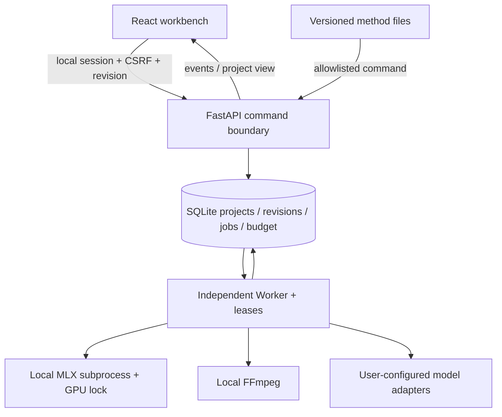

# 架构、状态与 API



The director interprets intent and proposes changes. Deterministic services own revisions, source ranges,
budgets, authorizations, jobs and adoption. The UI does not grant arbitrary execution to a skill.
Generated media and a selected candidate are separate concepts.

## Main data

- `Project`: brief/context, blocks, shots, audio, asset references, route, revisions and approvals.
- `SourceRange`: asset, source start/end and `pending/usable/rejected`. Composition time derives from shot order.
- `TranscriptSegment`: source start/end, original text, corrected text and included flag.
- `VideoCandidate`: media, task/model, input hash, design/route snapshot and optional source interval.
- `EditProposal`: scoped target, source snapshot, changes, effects and `proposed/applied/rejected/stale`.
- `Job`: durable state, input snapshot, lease, result/unknown state and provider task ID.
- `Budget/Attempt`: limits, reserved/settled entries and billing interpretation. Restoration never erases fees.

## Critical rules

Commands check `expected_revision` and `idempotency_key`. A repeat command can return its recorded result.
Paid submissions in an uncertain state are not turned into a new provider request without investigation.
Only matching inputs can make a job current; old results become candidates/superseded results.
ASR uses the application's optional dependency, a persistent job and a host-level lock, with no cloud fallback.
Source footage/audio cuts use the same interval; text corrections alone do not cut audio.

Navigation is not execution authorization. Creative, route, asset, price and final-review validity are checked
when the corresponding command executes. A ZIP import remaps assets and clears approvals; imported uncertain
costs remain uncertain records. The last 50 project revisions can be exported/recovered.

## Local API

Base URL: `http://127.0.0.1:8768/api`. This is not a remotely deployable public API.

| Endpoint | Purpose |
|---|---|
| `GET /health` | API, worker and FFmpeg availability; not a provider quality check |
| `GET /bootstrap` | Establish local cookie and return CSRF/session metadata |
| `GET /capabilities` | Read local ASR, model and internal Skill status |
| `GET/PUT /settings` | Read/update model configurations with settings revision |
| `POST /projects` | Create a project; does not generate media |
| `GET /projects/{id}` | Current document and computed validity |
| `POST /projects/{id}/commands` | Revisioned/idempotent mutation or durable task request |
| `GET /projects/{id}/jobs` | Task results, errors and execution state |
| `GET /projects/{id}/budget` | Application cost records |
| `GET /projects/{id}/revisions` | Recent content revisions |
| `GET /projects/{id}/export` | Current reviewed MP4 |
| `GET /projects/{id}/subtitles` | SRT |
| `GET /projects/{id}/archive` / `POST /import-archive` | Project ZIP export/import |

Command shape:

```json
{
  "type": "save_source_range",
  "expected_revision": 12,
  "idempotency_key": "a-new-unique-key-for-this-operation",
  "payload": {
    "shot_id": "YOUR_SHOT_ID",
    "range": {"asset_id": "YOUR_ASSET_ID", "start": 3, "end": 7, "status": "usable"}
  }
}
```

Session/CSRF example using the installed Python environment:

```python
import httpx
with httpx.Client(base_url="http://127.0.0.1:8768/api") as client:
    bootstrap = client.get("/bootstrap")
    bootstrap.raise_for_status()
    client.headers["x-studio-csrf"] = bootstrap.json()["csrf"]
    projects = client.get("/projects")
    projects.raise_for_status()
    print([(p["id"], p["name"]) for p in projects.json()])
```

Do not print credentials or include bootstrap/session data in public issues. Source and generated
OpenAPI are authoritative for full endpoint schemas. A session can expire after restarting the API;
the frontend attempts to re-establish it before retrying eligible requests.

## Extension boundary

`studio/recipes/` supplies methods; `studio/skills.py` maps fixed Skill IDs to allowed commands.
`brand-shot → refine_shot`, `ip-rough-cut → refine_transcript`. Both produce human-reviewable proposals
using the existing configured cognitive model and budget boundary. They do not install remote skills
or execute free-form shell/network programs. Add or replace an adapter only with capability, parameter,
fee/unknown-submission and result-contract tests. See [CONTRIBUTING](../CONTRIBUTING.md).
