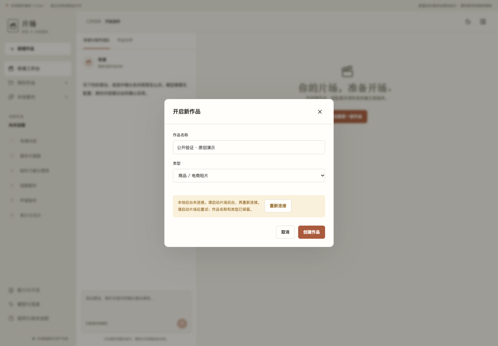

# 首发验证说明

日期：2026-10-12。验证的是公开源码副本，不复制内部客户数据或已授权模型账户。

| 证据层 | 当次结果 | 不能据此推出 |
|---|---|---|
| 后台回归 | 66 项通过，Python 3.12；包含源区间、声画、非整帧误差、候选/恢复、预算/幂等/未知提交、Skill 和历史导入 | 所有供应商都已真调用成功，或商业内容品质达标 |
| 前端 domain 逻辑 | 24 项通过；属于保留的模拟域逻辑测试 | 当前真实工作台的全部浏览器交互都被覆盖 |
| TypeScript + Vite | 类型检查和构建通过 | 用户任务一定成功 |
| HTTP / Worker / FFmpeg | 自动生成 6 秒色卡/音调，验证字幕、声音、任务、审片阻断、导出、重启、项目包恢复；0 AI/付费调用 | AI 生成视频效果或降本比例 |
| 新 UI 故障回归 | 模拟创建连接拒绝，错误位于前景 dialog；名称保留，恢复后重试成功；断开后有持续提示；无 pageerror | 每种认证和网络错误都已测试 |
| 启动入口 | shell 检查与隔离端口实际启动，日常数据目录不用于测试 | 登录自启、关闭终端后持续运行 |

相关代码：`app/backend/tests/`、`app/frontend/src/domain.test.ts`、`scripts/verify_local_flow.py`、`scripts/verify_ui.py`。
本地证明和视频在 `app/verification/`，被 Git 忽略；公开截图只使用合成测试数据。
首发尚未启用 GitHub Actions；[CI 模板](../.github/ci-template.yml) 已准备，需仓库维护者具备 Workflow 写权限后安装。
运行时日志在测试数据目录 `logs/`，默认业务库、API Key、生产 ZIP 和私人素材没有参与发布。



## 重跑

```bash
uv sync --project app/backend --locked --extra dev
app/backend/.venv/bin/python -m pytest app/backend/tests -q
npm --prefix app/frontend ci --ignore-scripts --no-audit --no-fund
npm --prefix app/frontend test
npm --prefix app/frontend run build
app/backend/.venv/bin/python scripts/verify_local_flow.py
```

可选的浏览器回归需要已安装 Chrome 和 Playwright。先在一个终端启动隔离服务器，另一个运行：

```bash
# Terminal 1 — never use a production data directory here
STUDIO_OPEN_BROWSER=0 bash scripts/start.sh --port 8889 --data-dir "$PWD/runtime/public-ui"
# Terminal 2
uv run --with playwright --python 3.12 python scripts/verify_ui.py
```

该脚本只在 8889 测试实例里创建演示作品；使用独立 headless context，不打开用户 Chrome profile。
脚本不自动安装浏览器，也不调收费模型。它模拟请求失败，不会停止业务服务。

## 模型与内容证据

内置模型预设和适配器的代码契约不等于所有账户的真实调用。自动 ASR 也需要权重缓存。
内部早期曾对本地 Whisper、两种 Skill 和样片制作做过实际验证，但这些私人原片、账本和模型会话
没有发布；不能把它们当作别人冷安装后已经通过的保证。本次不重新调用收费模型。

建议每个使用者分别记录：接口/账户可用、参数可用、真实产物可播放、内容审阅通过与最终费用。
生成的人物、商品文字、语义、授权素材和自然表达须由内容负责人查看，软件没有自动签收商业内容。
